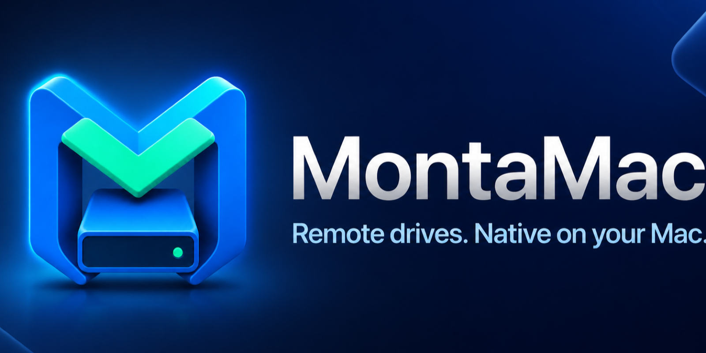
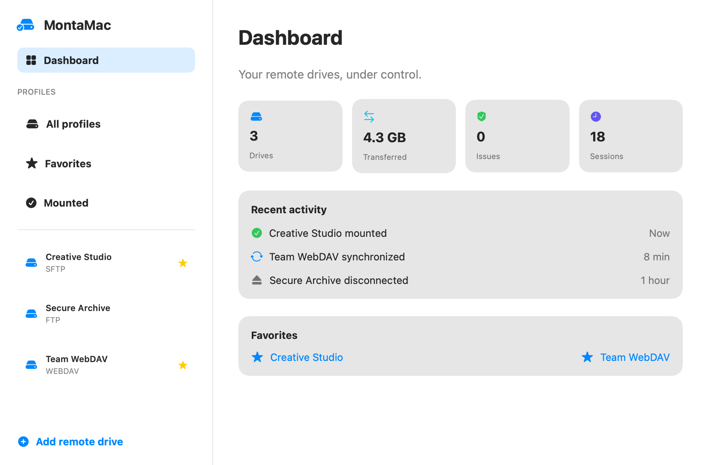
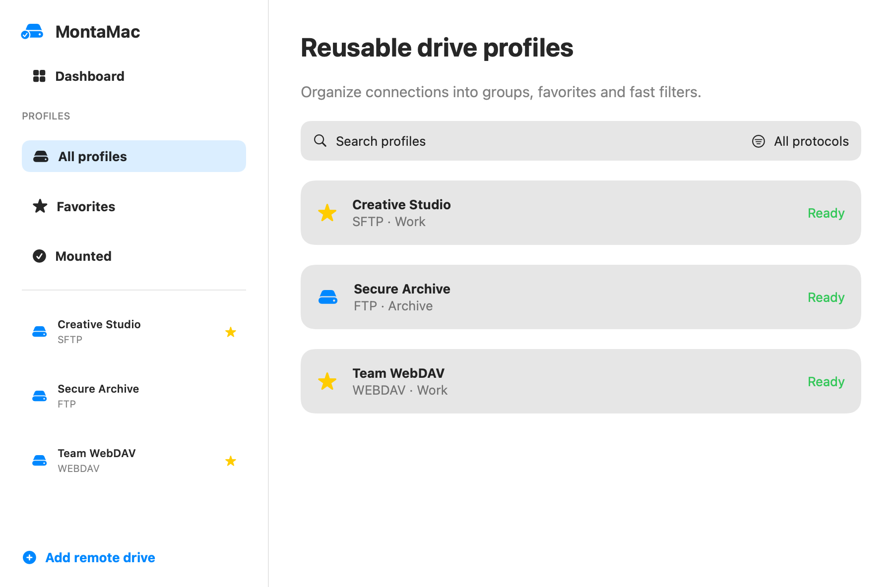
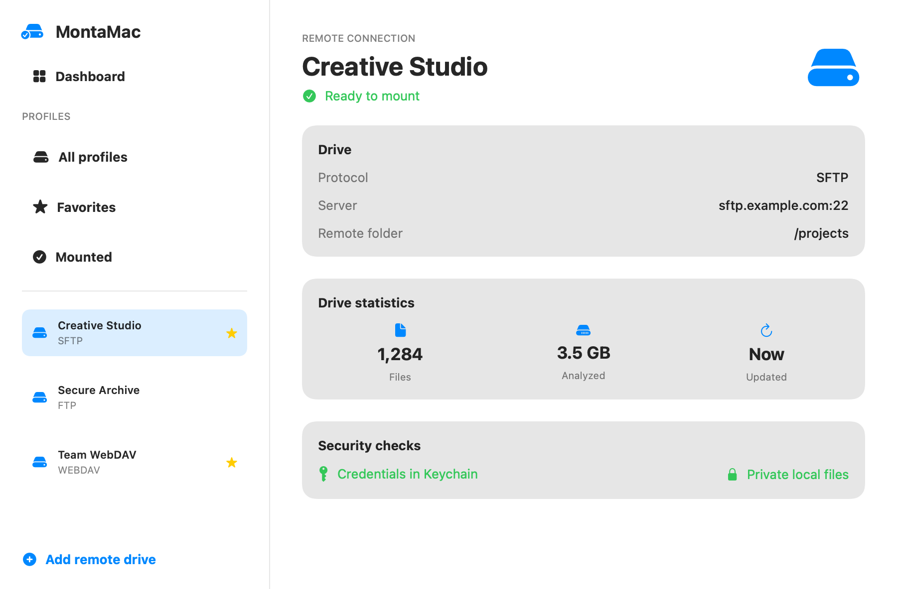

<div align="center">



# MontaMac

### Mount remote storage directly in Finder.

A native, open-source macOS app for turning **SFTP, FTP and WebDAV** storage into reusable Finder drives—without rebuilding long terminal commands every time.

[](https://github.com/CultureDigitali/MontaMac/releases/latest)
[](#requirements)
[](Package.swift)
[](https://github.com/CultureDigitali/MontaMac/actions/workflows/ci.yml)
[](LICENSE)

### [Download latest release](https://github.com/CultureDigitali/MontaMac/releases/latest) · [Quick start](#quick-start) · [⭐ Star MontaMac](https://github.com/CultureDigitali/MontaMac)

*A star helps other Mac users discover the project.*

</div>

## Why MontaMac?

Remote storage should feel like part of your Mac. MontaMac gives rclone and FUSE-T a focused native interface, stores credentials in macOS Keychain and brings your remote folders directly into Finder.

- **One-click mounting** — recall a saved drive instead of rebuilding commands.
- **Finder-native workflow** — open the exact mounted folder automatically.
- **Profiles that scale** — search, group, favorite and filter your connections.
- **Security by default** — Keychain credentials, private local files and redacted logs.
- **Useful visibility** — dashboard, activity history, statistics and diagnostics.
- **Four languages** — Italian, English, French and Spanish throughout the app.

## Product tour

All hosts and data shown below are synthetic `.example` demonstration values.

| Dashboard | Reusable profiles |
| --- | --- |
|  |  |



## Built for everyday remote-drive work

| Capability | MontaMac |
| --- | --- |
| Protocols | FTP, SFTP and WebDAV over HTTPS |
| Finder integration | Mount and open the configured local folder |
| Profile manager | Search, groups, favorites and mounted-drive filters |
| Credentials | Stored in macOS Keychain |
| Local data | Private `0700` directories and `0600` files |
| Insights | Activity dashboard, file statistics and diagnostics |
| Dependencies | Guided checks for rclone and FUSE-T |
| Interface | Native SwiftUI for macOS |

### MontaMac vs. a manual mount

| Manual command-line workflow | MontaMac workflow |
| --- | --- |
| Re-enter flags, remote paths and mount locations | Save a reusable profile once |
| Keep credentials and config handling in mind | Store passwords in Keychain automatically |
| Inspect processes and paths when something fails | Read status, logs and diagnostics in one place |
| Repeat the setup for every remote | Search, favorite and mount profiles from one window |

MontaMac does not replace rclone—it makes a focused remote-drive workflow accessible through a native Mac app.

## Quick start

1. Download `MontaMac-2.1.0.pkg` and its checksum from the [latest release](https://github.com/CultureDigitali/MontaMac/releases/latest).
2. Verify the package in Terminal:

   ```bash
   shasum -a 256 -c MontaMac-2.1.0.pkg.sha256
   ```

3. Install MontaMac, open it from Applications and follow the guided dependency check.

> [!IMPORTANT]
> Release 2.1.0 uses Hardened Runtime but is **not notarized with an Apple Developer ID**. macOS Gatekeeper may show a warning. Install only from this repository after verifying the SHA-256 checksum.

## Requirements

- macOS 15 or newer
- [rclone](https://rclone.org/)
- [FUSE-T](https://www.fuse-t.org/)

MontaMac checks these requirements and offers an installation command only after confirmation.

## Security and privacy

- Passwords never enter profile JSON files.
- Credentials are available only while the user session is unlocked.
- Each profile receives private rclone configuration and VFS cache locations.
- Sensitive rclone output is redacted from application logs.
- Dangerous system mount paths are rejected.
- FTP is supported for compatibility but does not encrypt credentials or data; prefer SFTP or WebDAV HTTPS.

Please report vulnerabilities privately according to [SECURITY.md](SECURITY.md). Never post credentials, private hosts or production logs in a public issue.

## Build from source

```bash
git clone https://github.com/CultureDigitali/MontaMac.git
cd MontaMac
swift test
zsh Scripts/build-app.sh
zsh Scripts/build-pkg.sh
```

The package script creates `dist/MontaMac-2.1.0.pkg`. See [CONTRIBUTING.md](CONTRIBUTING.md) before proposing changes.

## Roadmap and community

- See what is shipping and being explored in the [public roadmap](ROADMAP.md).
- Found a bug? [Open a redacted bug report](https://github.com/CultureDigitali/MontaMac/issues/new/choose).
- Have an idea? [Start a feature request](https://github.com/CultureDigitali/MontaMac/issues/new/choose).
- Want to help? Read the [contribution guide](CONTRIBUTING.md).

Stars, thoughtful issues, translations, tests and pull requests all help MontaMac grow.

## Italiano

**MontaMac monta storage FTP, SFTP e WebDAV direttamente nel Finder**, con un’interfaccia nativa per macOS. Salva i drive come profili riutilizzabili, organizzali in gruppi e preferiti, conserva le password nel Portachiavi e controlla attività, statistiche e diagnostica da un’unica finestra.

### Installazione rapida

1. Scarica il pacchetto dalla [release più recente](https://github.com/CultureDigitali/MontaMac/releases/latest).
2. Verifica il checksum SHA-256 con il comando mostrato sopra.
3. Installa l’app e completa il controllo guidato di rclone e FUSE-T.

La versione 2.1.0 non è notarizzata con Apple Developer ID: macOS può mostrare un avviso Gatekeeper. Scarica MontaMac esclusivamente da questa repository e verifica sempre il checksum.

## Credits

Created by **Luigi Strazzullo** for **[Culture Digitali Srl](https://culturedigitali.eu/)**.

- Email: [info@culturedigitali.eu](mailto:info@culturedigitali.eu)
- Office: Via Coroglio 57D, 80124 Napoli, Italy
- VAT: IT09465861210

## License

MontaMac is released under the [MIT License](LICENSE). Copyright © 2026 Culture Digitali Srl.
